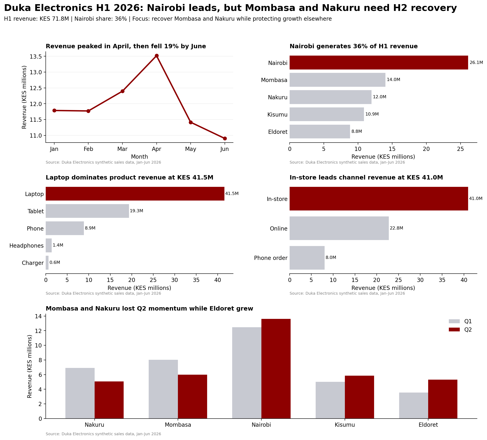

# Assignment 4: Student Performance EDA and Duka Board Visual Report

This repository contains two data-analysis engagements completed for Week 4.

The first engagement analyses student performance data for a County Education Office. The goal is to identify learners who may need support and examine factors associated with stronger academic performance.

The second engagement analyses Duka Electronics H1 2026 sales data and presents the main findings in a one-page visual report for the board. The report focuses on revenue trends, branch performance, products, sales channels and areas that need attention in H2.

## Repository Contents

- `generate_data.py` — generates the student-performance dataset using seed 55 and the Duka Electronics dataset using seed 2026.
- `student_eda.ipynb` — complete student performance exploratory data analysis.
- `board_report.ipynb` — storyboard, chart makeover and code used to create the board report.
- `figures/` — student EDA charts and the before-and-after chart makeover.
- `reports/duka_board_report.png` — final one-page Duka Electronics board report.
- `dashboard.md` — public Looker Studio dashboard link and screenshots.
- `requirements.txt` — Python libraries required for the analysis.

## How to Run the Project

1. Clone the repository:

`git clone https://github.com/robyke/plp-da-a4-student-eda-and-board-report.git`

2. Enter the repository:

`cd plp-da-a4-student-eda-and-board-report`

3. Install the required libraries:

`pip install -r requirements.txt`

4. Generate the datasets:

`python generate_data.py`

This creates:

- `student_performance.csv`
- `duka_sales.csv`

5. Open and run `student_eda.ipynb` from top to bottom.

6. Open and run `board_report.ipynb` from top to bottom.

The notebooks can also be opened and run in Google Colab.

# Engagement 1: County Education Office

The student dataset contains 1,200 learners. Each row represents one student and includes county, school type, gender, attendance rate, study hours and scores in Mathematics, English and Science.

The analysis follows five EDA steps:

1. Structure
2. Univariate
3. Bivariate
4. Multivariate
5. Hypotheses

Two additional variables were created:

- `average_score` — the average of Mathematics, English and Science.
- `performance_band` — At Risk, Meeting or Exceeding.

## Five Key EDA Insights

1. **8.25% of students are At Risk.** There are 99 At Risk learners out of 1,200 students. These learners are the most important group for targeted academic support.

2. **Study hours have a strong positive relationship with performance.** Study hours have a correlation of 0.704 with average score. The fitted trend line has a slope of 2.12, meaning one additional study hour is associated with about 2.12 additional average-score points. The R² is 0.495.

3. **Attendance is positively associated with performance.** Attendance rate has a correlation of 0.359 with average score. Students in higher attendance bands generally record higher average scores.

4. **Private-school students have higher average scores than Public-school students.** Private-school students average 76.01 compared with 70.46 for Public-school students. The gap remains within every attendance band and every study-hour quartile.

5. **Nairobi has the highest share of At Risk learners.** Nairobi has 9.24% of its students in the At Risk band. Kisumu has the highest overall average score at 73.07, while Turkana has the lowest at 70.97.

## Student EDA Recommendations

The County Education Office should prioritise the 99 At Risk learners, especially students with low attendance or low study hours. Nairobi should receive particular attention because it has the highest share of At Risk learners.

The school-type performance gap should also be investigated further. Additional information on teacher availability, household conditions, class size and learning resources would help explain why the gap remains after comparing attendance and study-hour groups.

## Student EDA Limitations

The student-performance dataset is synthetic and does not include every factor that could affect academic performance. Important variables such as household income, teacher quality, class size, learning resources and previous academic performance are not available.

The relationships between study hours, attendance, school type and scores represent association rather than proof of causation. The study-hours trend line assumes a linear relationship and should not be used to make predictions far outside the observed range.

# Engagement 2: Duka Electronics Board

Duka Electronics generated KES 71.8 million in H1 2026.

Nairobi remained the largest branch with KES 26.11 million in revenue. Monthly revenue peaked in April at KES 13.52 million before falling in May and June.

Laptop sales generated the most product revenue at KES 41.54 million, followed by Tablets at KES 19.35 million. In-store sales remained the largest channel at KES 40.97 million.

The most important change was in branch momentum between Q1 and Q2. Eldoret and Kisumu improved, while Mombasa and Nakuru weakened.

## Final One-Page Board Report

## Board Summary

Duka Electronics generated KES 71.8 million in H1 2026, with Nairobi contributing the largest share of revenue at about 36%. Revenue reached its highest level in April before weakening in May and June, showing softer momentum as the business entered H2. Laptops remained the strongest product by revenue, while In-store sales remained the leading channel. Branch performance was uneven. Eldoret showed the strongest Q2 improvement, while Kisumu and Nairobi also grew. In contrast, Mombasa and Nakuru recorded clear Q2 declines compared with Q1. The recommended H2 focus is to prioritise recovery actions in Mombasa and Nakuru while protecting positive momentum in Eldoret, Kisumu and Nairobi. Management should monitor monthly revenue, branch performance, product results and channel performance through the Looker Studio dashboard. This will allow the board to identify changes quickly, adjust H2 actions when needed, and direct marketing resources toward branches with the clearest recovery opportunities.

## Looker Studio Dashboard

Public dashboard:

https://datastudio.google.com/reporting/9aeae31c-3717-4fe5-b92a-24864752e9f2

The dashboard includes:

- Total Revenue scorecard
- Total Orders scorecard
- Average Order Value scorecard
- Monthly revenue trend
- Revenue by branch
- Revenue by product
- Date-range control
- Channel filter

## Duka Report Limitations

The Duka Electronics dataset is synthetic and covers only January to June 2026. H1 patterns should not be assumed to continue automatically into H2. The report should therefore support management decisions together with continued monitoring through the dashboard.
