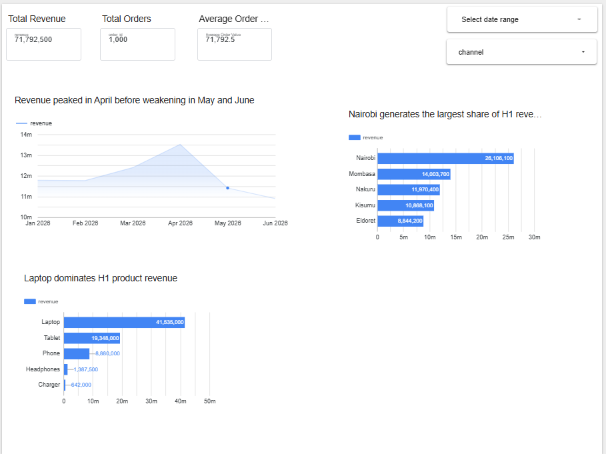
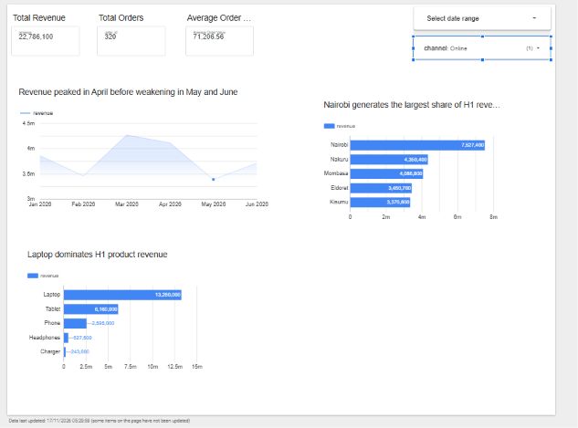

# Duka Electronics H1 2026 Board Sales Dashboard

## Public Looker Studio Dashboard

https://datastudio.google.com/reporting/9aeae31c-3717-4fe5-b92a-24864752e9f2

## Dashboard Summary

The dashboard provides an interactive view of Duka Electronics H1 2026 sales performance. It includes three KPI scorecards for total revenue, total orders and average order value. It also includes a monthly revenue trend, revenue breakdowns by branch and product, a date-range control and a channel filter.

The dashboard shows that Duka Electronics generated KES 71.79 million in H1 2026 from 1,000 orders, with an average order value of KES 71,792.50. Revenue peaked in April before declining in May and June. Nairobi generated the highest branch revenue, while Laptop was the strongest product by revenue.

## Screenshots

### Dashboard Overview

### Dashboard Filtered View

## Data Source

Duka Electronics synthetic sales data, January to June 2026.
